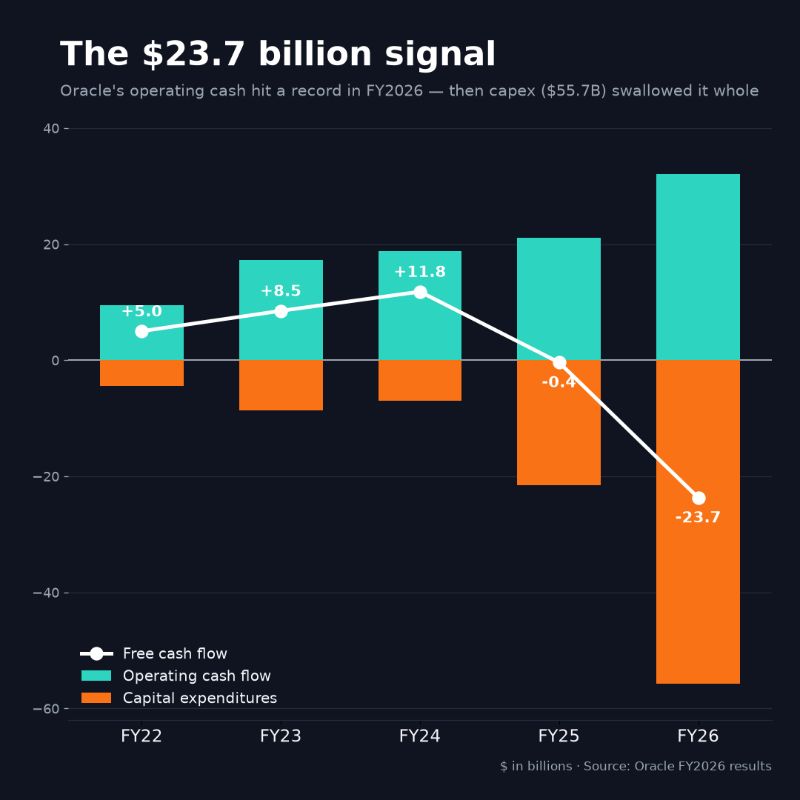
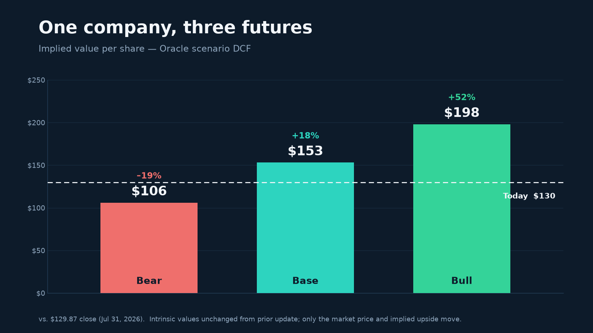

*Oracle is running the clearest public-market experiment we have on whether AI infrastructure can earn its cost of capital. The financial statements don't answer the question yet — but they tell us exactly what to watch, and they reveal what the market is already assuming.*

*Originally published July 17, 2026; updated July 31, 2026 to reflect current market pricing.*

---

In fiscal 2026, Oracle generated \$32.0 billion of operating cash flow — the most in its history.

In the same year, it spent \$55.7 billion building things.

The arithmetic is not subtle. Oracle's free cash flow — the money left after the bills of growth are paid — was **negative \$23.7 billion**. That figure is not an accounting curiosity or a rounding artifact. It is the financial signature of one of the boldest strategic pivots in modern corporate history.

Oracle is taking the cash flows, borrowing capacity, and hard-won credibility of a mature enterprise-software company and pouring them into a far more capital-intensive AI infrastructure business. That makes Oracle more than a single investment case. It has become a live, public test of whether the entire AI infrastructure boom can convert extraordinary demand into acceptable returns.

Demand, notably, is not the open question. In its June 10, 2026 fiscal-year-end report, Oracle disclosed **\$638 billion of remaining performance obligations** — its contracted-but-not-yet-recognized backlog — up 363% year over year and up \$85 billion in a single quarter. Against annual revenue of \$67.4 billion, that is an almost surreal figure. The question is not whether customers want the capacity. It is whether serving that demand will earn more than it costs.

My own assessment is deliberately balanced. Oracle's spending should not yet be called capital destruction: it has contracted demand, meaningful customer funding of hardware, and a profitable software franchise underwriting the expansion. But neither should the program be presumed disciplined simply because the contracts are enormous. The burden of proof has shifted. Oracle must now show that its new infrastructure earns more than its cost of capital *after* depreciation, replacement spending, power, financing, and customer risk are all accounted for.

Everything that follows is an attempt to say, as precisely as the numbers allow, what that proof would look like.

## The architecture underneath the demand

It is worth pausing on *why* the demand is there, because the answer is not only price. Oracle came late to cloud infrastructure, and lateness turned into an advantage: it designed its second-generation architecture after watching where the first generation broke.

The central design choice is deceptively technical. In a conventional cloud, the software that manages the network — the "control plane" — runs on the very same servers that run the customer's workloads. It is efficient, but it means that a customer who breaks out of their own virtual machine and compromises that shared layer can, in principle, reach the network and the data crossing it. Oracle moved that control plane *off the box entirely*, onto dedicated, custom-built network cards — SmartNICs — that sit physically apart from the servers doing the customer's computing. Oracle calls it isolated, or off-box, network virtualization.

The consequences run in two directions, and both feed demand. Security first: a compromised customer instance cannot reach a control plane that lives on separate silicon, which shrinks the attack surface for exactly the regulated, security-conscious buyers — banks, governments, health systems — who are Oracle's traditional stronghold. For customers who need tighter control still, Oracle will install an entire cloud region inside their own data center, behind their own firewall. Performance second: with virtualization off the host, customers get near-bare-metal machines with predictable latency, and Oracle can lash tens of thousands of GPUs together with high-throughput cluster networking — precisely the profile AI training demands. Oracle reported running its GPU fleet at roughly 97.5% utilization in fiscal 2026, which is not the number of a company struggling to fill capacity.

None of this guarantees good economics. But it explains why the backlog is real rather than promotional: Oracle is winning a particular kind of customer for particular architectural reasons, not merely discounting its way into the boom. The engineering is why the demand showed up. The rest of this analysis is about whether the demand will pay.

## From software economics to infrastructure economics

Oracle's historical business was attractive for reasons every investor recognizes. Database licenses, software support, and cloud applications throw off recurring revenue with modest capital requirements. Once the software exists, serving one more customer costs almost nothing. That structure produces high margins and clean conversion of profit into cash.

The new Oracle has a different physics.

Capital spending went from roughly \$7 billion in fiscal 2024 to \$21.5 billion in fiscal 2025 to \$55.7 billion in fiscal 2026 — nearly an eightfold increase in twenty-four months. Cash now leaves the building at a pace the old software model never contemplated.

### Exhibit 1 — Oracle's cash-flow transformation

| Fiscal year | Revenue | Operating cash flow | Capital expenditures | Free cash flow |
|---|---:|---:|---:|---:|
| 2022 | \$42.4B | \$9.5B | \$4.5B | \$5.0B |
| 2023 | \$50.0B | \$17.2B | \$8.7B | \$8.5B |
| 2024 | \$53.0B | \$18.8B | \$7.0B | \$11.8B |
| 2025 | \$57.4B | \$21.1B | \$21.5B | \$(0.4)B |
| 2026 | \$67.4B | \$32.0B | \$55.7B | **\$(23.7)B** |


*Oracle's record operating cash flow was overtaken by the scale of its fiscal-2026 capital expenditures.*

<aside class="article-note formula-note" markdown="1">
<p><strong>Free cash flow</strong>, put simply, is: the cash a business produces from operations, minus what it must spend to keep running and to grow.</p>

```
Free cash flow = operating cash flow − capital expenditures
FY2026:          $32.0B − $55.7B  =  −$23.7B
```
</aside>

A hurried reader might see that last row and conclude Oracle's economics have deteriorated. That reading is not just incomplete; it is nearly backwards. Operating cash flow *rose more than 50%* over the prior year. Revenue grew 17%. Operating income reached \$20.6 billion. The legacy engine is running harder than ever.

Oracle's free cash flow collapsed not because the business weakened, but because management chose to invest faster than even a record year of cash generation could fund.

That distinction matters — though only up to a point. Executives like to sort capital spending into two bins: *maintenance* capital expenditures, which preserve today's earning power, and *growth* capital expenditures, which are meant to buy tomorrow's. In practice the line is porous. New data centers age. GPUs become obsolete on brutal timelines. Power, cooling, and networking gear all wear out and must be replaced. A bigger asset base carries a bigger permanent bill just to stand still. Even if most of Oracle's current spending is genuinely growth, the company will emerge from this cycle with structurally higher maintenance needs. It may spend less than it does today. It will not return to the capital diet of the old software business.

## A backlog is not a return

The \$638 billion backlog is the single strongest argument for the strategy. It says Oracle is not building on faith that customers will someday materialize; large customers have already signed. Oracle also reported that roughly **\$75 billion of associated hardware has been prepaid by customers or supplied by them directly** — an arrangement management says "substantially reduces the amount of capital Oracle must raise to build out our AI datacenters." That lowers the financing burden and takes some stranded-equipment risk off the table.

But a backlog is a promise of revenue, not a measure of value — and the two can diverge violently.

A contract creates value only when the present value of what comes in exceeds the present value of what must go out to deliver it:

```
Contract value = present value of ( revenue − operating costs − taxes − reinvestment )
```

The backlog tells us about the first term. It says almost nothing about the others. And in the shift from software to infrastructure, the others are exactly what change. A dollar of software revenue may require almost no incremental capital. A dollar of infrastructure revenue may require servers, real estate, power, cooling, fiber, and a standing obligation to replace the hardware every few years. The same top line can hide radically different economics underneath.

Picture two companies, each signing a \$10 billion contract.

Company A fulfills it on an existing software platform, earns a 45% after-tax operating margin, and invests almost nothing new. Company B must first sink \$7 billion into physical plant, earns a 15% margin, and will replace much of that equipment within five years.

Both announce "\$10 billion of contracted demand." They have not created remotely the same amount of value. Oracle's backlog is real. The work of this analysis is figuring out which company it more closely resembles.

## The hurdle every dollar must clear

The right yardstick is return on invested capital. ROIC asks a deceptively simple question: for every dollar of capital a business ties up, how much after-tax operating profit does it earn? Set that against the cost of the capital — the blended return that debt and equity investors require, the weighted average cost of capital, or WACC — and the entire game reduces to one inequality:

```
ROIC  =  after-tax operating profit (NOPAT)  ÷  invested capital

Value is created only when  ROIC > WACC.
```

Our integrated valuation model uses a base-case WACC of 8.5%. Suppose Oracle ultimately commits \$150 billion of incremental capital to AI infrastructure. Merely to earn its cost of capital — not to impress anyone, simply to break even in economic terms — that investment must generate:

```
$150B × 8.5%  =  $12.75B  of sustainable annual after-tax operating profit
```

How much revenue that requires depends entirely on the margin the mature business earns.

### Exhibit 2 — Revenue required to clear an 8.5% return on \$150B

| After-tax operating margin | Required annual revenue |
|---:|---:|
| 15% | \$85.0B |
| 20% | \$63.8B |
| 25% | \$51.0B |
| 30% | \$42.5B |

At a 25% mature margin, Oracle needs about \$51 billion of recurring incremental revenue just to earn its cost of capital. At 15%, the bar climbs to \$85 billion. This is why the *eventual* economics of Oracle Cloud Infrastructure matter far more than the headline growth rate. A company can grow revenue thrillingly fast and still destroy value, if each new dollar of sales demands too much capital or carries too little profit.

The cleaner version of the same idea is *incremental* ROIC — the return on the new money, not the old:

```
Incremental ROIC = change in NOPAT ÷ change in invested capital

$2.0B ÷ $50B =  4%   (below the 8.5% cost of capital → value destroyed)
$7.5B ÷ $50B = 15%   (well above it            → value created)
```

Revenue rises in both stories. The difference shows up only when you insist on comparing the profit to the capital that produced it.

## Why the honest answer is "not yet"

Here is the uncomfortable truth for anyone wanting a verdict today: Oracle's reported statements *cannot* yet reveal the mature ROIC of this buildout, because infrastructure runs on a delay.

Cash leaves first. Construction follows. Equipment is installed. Only then do customers begin consuming capacity, and revenue ramps over quarters and years. Depreciation can start before utilization matures — dragging reported profit down early. Customer prepayments push in the opposite direction — flattering operating cash flow before the service has actually been delivered.

So the two numbers investors reach for are both, right now, unreliable narrators. Reported free cash flow is *artificially depressed* by growth investment. Reported operating cash flow is *artificially supported* by prepayments and by non-cash charges like depreciation and stock compensation. Neither is a clean read on what an owner will eventually pocket.

The useful question is therefore not "what was free cash flow this year?" It is: *what will free cash flow look like once these assets reach mature utilization and capital spending stabilizes?*

Our base case — drawn from an [integrated three-statement model](/assets/oracle-dcf/Oracle_Integrated_Model.xlsx) and summarized in the [accompanying valuation memorandum](/assets/oracle-dcf/Oracle_Valuation_Memo.pdf) — is one disciplined answer, a genuine midpoint between a cautious ramp and an aggressive one. It assumes another stretch of heavy cash outflow, then gradual normalization. (Notably, its fiscal-2027 revenue of about \$86 billion sits *below* management's own \$90 billion guidance — a deliberately conservative starting point.)

> **Model note:** The full integrated model and accompanying valuation memorandum are linked in the **Sources & notes** section below.

### Exhibit 3 — Selected base-case assumptions

| Metric | FY2027E | FY2029E | FY2032E | FY2036E |
|---|---:|---:|---:|---:|
| Revenue | \$86B | \$124B | \$167B | \$209B |
| Operating (EBIT) margin | 30% | 30% | 31.5% | 32.5% |
| Capital expenditures | \$78.5B | \$55B | \$30.5B | \$23B |
| Unlevered free cash flow | \$(39)B | \$(2)B | \$37B | \$55B |

Notice what this base case does *not* assume: it does not assume margins collapse under the weight of infrastructure. It holds operating margins near 30% and lets them drift gently higher as the mix matures. That is an optimistic posture, and worth naming plainly — it presumes Oracle's infrastructure revenue arrives at nearly software-like operating margins. If that premise is wrong, the damage shows up in the bear case, not the base. The base case is not a prediction that Oracle will trace this exact path. It is an explicit statement of what must broadly happen for the investment to work: capital spending has to fall by two-thirds even as revenue triples, and the operating margin has to hold.

## What the market is already paying for

A discounted-cash-flow model values a company as the present value of its future unlevered free cash flows, plus the present value of everything beyond the forecast — the terminal value:

```
Enterprise value = Σ [ FCF(t) ÷ (1 + WACC)^t ]  +  terminal value ÷ (1 + WACC)^n

Terminal value   = FCF in the first post-forecast year ÷ (WACC − g)
```

where *g* is the assumed perpetual growth rate. Feed the base case — 8.5% WACC, 3.0% terminal growth, capital spending normalizing, margins holding — into that machine and it returns an enterprise value near **\$549 billion** and, after subtracting net debt and preferred stock, an equity value near **\$446 billion**. Divide by roughly 2.9 billion diluted shares and the implied value is about **\$153 per share**. Against a reference price of \$129.87 — the close on Friday, July 31, 2026 — the base case implies about **18% upside**. That price marks only a partial recovery: Oracle had tumbled from roughly \$248 in early June to a 52-week low near \$115 in late July before rebounding, and even after the bounce the bear case still sits about 19% below the market. The market, in other words, now sits between the bear and base cases — no longer pricing the downside in full, but far from crediting the bull.

That single number, though, is the least interesting thing the model produces — and it deserves to be interrogated with the very framework we just built.

Roughly **83% of Oracle's entire enterprise value sits in the terminal value** — the one line meant to capture everything past year ten. And that terminal value quietly assumes something remarkable. To grow 3% a year forever, the base case has Oracle reinvesting *less than two cents of every dollar* of after-tax profit. Run that through the ROIC lens, and the model is implicitly assuming a steady-state return on new capital *well above 100%* — the capital efficiency of the old software business, not the asset-heavy infrastructure business this entire analysis is about.

That is the deepest tension in the whole exercise. A more disciplined terminal value — one that forces Oracle to reinvest like the physical business it is becoming — is materially lower. On an exit-multiple basis the terminal looks more defensible: it implies about 11.7 times EBITDA (the final year's operating earnings before depreciation), rich but not outlandish. The gap between those two readings is not a flaw to bury in a footnote. It *is* the honest measurement of how much of Oracle's value depends on assumptions no one can yet verify.

Which is why the range matters far more than the point estimate.

### Exhibit 4 — DCF scenario values

| Scenario | Key operating assumptions | Implied value per share |
|---|---|---:|
| Bear | Slower revenue, softer margins, heavier capital expenditures | **\$106** (−19%) |
| Base | Guided growth, stable margins, capital expenditures normalizing | **\$153** (+18%) |
| Bull | Faster growth, expanding margins, lower long-run capital expenditures | **\$198** (+52%) |


*The valuation range is driven by operating outcomes; all three scenarios use the same 8.5% discount rate.*

<aside class="article-note scenario-note" markdown="1">
<p><strong>How to read the range:</strong> all three scenarios use the same 8.5% discount rate. The spread comes entirely from the operations:</p>

- how fast revenue grows;
- how margins behave;
- how much capital the buildout consumes.

<p>The aggressive path that anchors the bull column — revenue reaching $90 billion in fiscal 2027, in line with management's guidance, and climbing from there — is not a fantasy; it is roughly what Oracle itself is guiding toward.</p>

<p>A range from $106 to $198 is wide. It should be. Small differences in the productivity of infrastructure capital compound into large differences in equity value.</p>
</aside>

## The upside is financed

That compounding runs through the balance sheet, and the balance sheet is where the strategy's risk becomes concrete. Oracle's equity now sits behind roughly **\$129.5 billion of debt** and about **\$5 billion of preferred stock**. The bridge from the business to the shareholder is unforgiving:

```
Equity value = enterprise value − debt + cash − preferred stock
```

Leverage magnifies. If the buildout succeeds, shareholders keep the value created after the contractual claims are paid. If it disappoints, the debt does not shrink to match; the loss concentrates in the equity. That is simply what leverage does.

Consider what the bull case actually demands of that balance sheet. Push Oracle onto the aggressive path — roughly \$95 billion of capital spending in fiscal 2027 — and run it through the full financial statements, and something instructive happens: **the company runs out of cash.** In fiscal 2028 and 2029, our model shows the cash balance turning *negative* by roughly \$15 billion, even as the operating business throws off record amounts. To stay solvent on that trajectory, Oracle would need to raise on the order of **\$16 to \$17 billion more** — beyond everything already planned.

This is not a hypothetical the market has ignored. Oracle has already told investors it intends to raise about \$40 billion in fiscal 2027, including a \$20 billion at-the-market equity issuance — and the stock fell roughly 10% the day those plans landed. The message from the tape is clear: the bull case is not a gift. Its upside is *financed*. And financing it means either more leverage on an already-stretched balance sheet, or new shares that dilute the very upside investors are underwriting. The most optimistic story for the business is not automatically the most optimistic story for the stock.

## The OpenAI question

No account of Oracle's bet is complete without naming the customer at its center. Analysts estimate that well over half of that \$638 billion backlog traces to a single relationship — OpenAI, and the gigawatt-scale "Stargate" data-center initiative it anchors. OpenAI is both the attraction and the risk.

If OpenAI becomes one of the world's dominant computing platforms, having locked in a large share of its infrastructure demand could prove immensely valuable — the corporate equivalent of building the power plants for an industry whose eventual scale is hard to picture today. But Oracle's fortunes then depend on the continued commercial success, and continued financing access, of counterparties whose own economics are still being written.

The issue is not whether OpenAI will fail; public information cannot responsibly support that claim. The issue is *concentration*. When a supplier builds specialized capacity around a handful of customers, its risk is not captured by contract value alone. It depends on customer liquidity, on contract flexibility, on the timing of deployment, and on whether the assets can be repurposed if demand shifts.

An AI data center is not automatically stranded when one customer pulls back. Capacity can, in principle, be reassigned. But "in principle" carries real analytical weight. Location, power availability, hardware configuration, software compatibility, and pricing all determine whether redeployment is fast, profitable, or even possible. The optionality is genuine. So is the fragility.

## What would actually prove it

Investors will fixate on revenue growth, backlog, and quarterly cloud bookings. Those numbers matter. They are also, on their own, insufficient — because every one of them can rise while value quietly erodes.

The evidence that will actually settle the question lives in a chain:

```
revenue growth → operating profit → free cash flow → return on invested capital
```

Oracle must eventually demonstrate that incremental cloud revenue produces operating profit at a rate that outruns incremental depreciation, maintenance capital, and the cost of financing. The disclosures that would let investors see this are specific:

- operating margins on *mature* AI infrastructure capacity, not the blended average;
- utilization rates by facility cohort;
- maintenance and replacement capital requirements as the fleet ages;
- customer concentration and the structure of prepayments;
- and the invested capital sitting behind recognized OCI revenue.

Oracle may never report all of it directly. Investors will have to triangulate — from depreciation, segment margins, capital spending, contract liabilities, and the drift of operating cash flow. That difficulty is precisely what makes the case so compelling to study. Oracle is trying to turn a familiar software franchise into something the public markets have few mature analogues for: a business with the contracted demand of a utility, the obsolescence risk of a semiconductor ecosystem, the financing profile of an infrastructure developer — and, still, the strategic optionality of a global software platform.

Oracle is not simply betting on artificial intelligence. It is testing whether enormous AI demand can be converted into returns for common shareholders once the full economic cost of the infrastructure — every dollar of depreciation, replacement, power, and interest — is finally recognized.

The next earnings release may tell us whether revenue is arriving faster than expected, or whether the backlog grew again. Those are the easy questions.

The one that matters will take years:

*When Oracle's first great generation of AI data centers reaches mature utilization, how much sustainable after-tax operating profit will each \$100 of invested capital actually produce?*

Everything else is prologue.

---

### Sources & notes

- **Financial results, RPO, hardware funding, and capital-raising plans:** Oracle Corporation, ["Oracle Announces Record Q4 and FY 2026 Results Driven by Cloud Infrastructure & Cloud Applications"](https://investor.oracle.com/investor-news/news-details/2026/Oracle-Announces-Record-Q4-and-FY-2026-Results-Driven-by-Cloud-Infrastructure--Cloud-Applications/), June 10, 2026. Reported \$638B RPO (+363% YoY, +\$85B sequentially), \$75B of prepaid/customer-supplied hardware, FY2026 free cash flow of −\$23.7B, and FY2027 plans to raise ~\$40B including a \$20B at-the-market equity issuance.
- **FY2027 guidance and net-capital-expenditure commentary** (~\$90B revenue; ~\$70B net capital expenditures): [Oracle Q4 FY2026 earnings call transcript](https://www.fool.com/earnings/call-transcripts/2026/06/10/oracle-orcl-q4-2026-earnings-call-transcript/), June 10, 2026.
- **OpenAI / Stargate concentration** (>50% of backlog): third-party analyst estimates following the Q4 FY2026 report.
- **Technology — off-box / isolated network virtualization:** Oracle, ["Oracle Cloud Infrastructure — Isolated Network Virtualization"](https://www.oracle.com/au/cloud/security/isolated-network-virtualization/) and ["Oracle Cloud Infrastructure Security Architecture"](https://www.oracle.com/middleeast-ar/a/ocom/docs/oracle-cloud-infrastructure-security-architecture.pdf).
- **Valuation figures:** the author's [integrated three-statement model](/assets/oracle-dcf/Oracle_Integrated_Model.xlsx) and scenario DCF (base case: 8.5% WACC, 3.0% terminal growth, normalized tax), detailed in the [accompanying valuation memorandum](/assets/oracle-dcf/Oracle_Valuation_Memo.pdf). Reference share price \$129.87 as of the July 31, 2026 close.

**Disclosures & disclaimer.** *Published by the author in a personal capacity; the views herein are solely the author's own and not those of Velocity Advisors or any other entity, and the author is not a registered investment adviser. This material is provided for informational and educational purposes only and does not constitute investment, legal, or tax advice or any recommendation, offer, or solicitation to buy or sell any security, including Oracle Corporation (ORCL); it disregards any reader's particular circumstances and creates no advisory or fiduciary relationship. As of the date hereof, the author holds no direct position in ORCL and no options or other derivatives thereon, though the author may hold incidental, indirect exposure through diversified exchange-traded or target-date retirement funds. All opinions, estimates, and projections herein are as of the publication date or the expressly noted update date, are subject to change without notice, and may not be updated further; valuation figures are model outputs whose assumptions may prove materially incorrect, and forward-looking statements are inherently uncertain and not guarantees of future results. Third-party information, including Oracle's public filings and earnings materials, is believed reliable but has not been independently verified and is not warranted as to accuracy or completeness. Nothing herein is a basis for any investment decision; readers should conduct their own research and consult their own financial, legal, and tax advisers. Modeled and hypothetical results are not indicative of future results. © 2026 Jason Abed. All rights reserved.*
